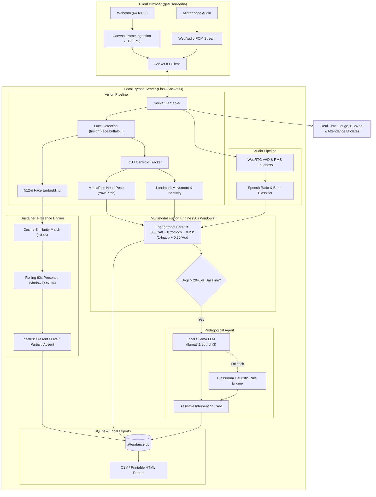

# Multimodal Attendance & Engagement Agent
> **An AI Classroom Assistant for Automated Sustained Attendance, Real-Time Multimodal Engagement Analytics, and Assistive Pedagogical Recommendations.**
> Developed by **Ashutosh Pandey** &bull; LNCT College &bull; Branch: **CSE AIML (3rd Year)** &bull; Email: `ashutoshpandey835797@gmail.com`

---

## 🌟 Key Features

1. **100% Offline & Edge-Native**: No cloud APIs or external server round-trips. Zero raw video or audio files are ever stored on disk—only derived metrics and 512-d averaged face embeddings.
2. **Sustained Presence Attendance Engine**: Eliminates proxy marking and false positives. Students are marked **PRESENT** only after confirmed presence in $\ge 70\%$ of frames over a rolling 60-second window. Automatic **ABSENT** marking for unseen enrolled students at session end.
3. **Multimodal Classroom Engagement**: Evaluates four synchronized telemetry signals in 30-second intervals:
   $$\text{Engagement} = 0.35 \times \text{Attention} + 0.25 \times \text{Movement} + 0.20 \times (1 - \text{Inactivity}) + 0.20 \times \text{Audio}$$
4. **Context-Aware AI Teaching Suggestions**: Integrates with local **Ollama** (`llama3.1:8b` with fallback to `phi3`) to offer supportive, decision-support interventions when engagement drops $>20\%$ below baseline. Built-in intelligent rule engine runs seamlessly if Ollama is not installed.
5. **5-Sample Biometric Enrollment Wizard**: Real-time quality validation (face size, blur/sharpness, lighting, single-face validation) before computing normalized averaged feature vectors.
6. **"Dark + Lime" Editorial Design System**: Premium interface featuring high-contrast dark surfaces (`#0A0A0A`, `#1A1D1A`), electric lime accents (`#C5F82A`), live marquee ticker, animated circular SVG gauge, and Chart.js telemetry graphs.
7. **Comprehensive Reporting**: One-click CSV register exports and standalone printable HTML/PDF reports.

---

## 🏗️ System Architecture



---

## 🚀 Quickstart & Setup

### 1. Requirements
- Python 3.10+ (Python 3.11 recommended)
- Windows / Linux / macOS
- Webcam and microphone (or synthetic camera mode enabled automatically)

### 2. Installation
```bash
git clone <repo-url>
cd multimodal-attendance-agent
pip install -r requirements.txt
```

### 3. Run Application
```bash
python app.py
```
Open your browser to:
```
http://localhost:5000
```

---

## ⚡ Hardware Acceleration (CUDA GPU / CPU)

- **GPU Acceleration**: The system automatically queries for `CUDAExecutionProvider` via ONNX Runtime. If an NVIDIA GPU (e.g. RTX 4050 Laptop GPU) and CUDA drivers are present, GPU mode is automatically activated.
- **CPU Fallback**: If CUDA is not detected or during sandboxed execution, it seamlessly operates on `CPUExecutionProvider` with downsampled resolution and frame skipping to maintain 20+ FPS.
- The active hardware state is displayed as a live badge in the top navigation bar (`CUDA (GPU)` or `CPU`).

---

## 🦙 Ollama Local LLM Setup (Optional)

The AI assistant connects locally to Ollama without any cloud dependencies:
1. Download Ollama from [ollama.com](https://ollama.com)
2. Pull the default model:
   ```bash
   ollama run llama3.1:8b
   ```
   *(Or for lightweight VRAM: `ollama run phi3`)*
3. If Ollama is not installed or running, the built-in `ClassroomRuleEngine` takes over automatically with zero errors.

---

## 🧪 Unit Tests & Benchmarks

Run the complete test suite:
```bash
pytest tests/ -v
```

Run performance and accuracy benchmarks:
```bash
python tests/run_benchmarks.py
```

---

## 👨‍💻 Developer Information

- **Name:** Ashutosh Pandey
- **Institution:** LNCT College
- **Branch / Year:** CSE AIML, 3rd Year
- **Email:** `ashutoshpandey835797@gmail.com`
- **License:** MIT Open Source
